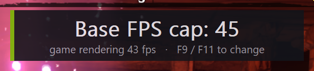

# EnshroudedBaseCap: base FPS cap for Enshrouded

[](https://github.com/Mycellius/EnshroudedFPSCap/actions/workflows/build.yml)
[](LICENSE)

**A frame cap for Enshrouded that limits the frames the game really renders, before frame generation multiplies them.**

Set it to 40 and your GPU renders 40 real frames a second. You still see 80 fps at 2x frame generation, or 120 at 3x. That means less heat and fan noise, with smooth motion.

It's an add-on for Biozilla's [Enshrouded DLSS Frame Generation](https://www.nexusmods.com/enshrouded/mods/141) mod.



## Why

Frame limiters in the NVIDIA Control Panel, the NVIDIA App or RTSS cap the **final** frame rate, after frame generation. With frame generation at 2x, a cap of 40 there means the game renders only 20 real frames. That feels sluggish, and you still don't know how hard your GPU is working.

| Setting | Frame gen | Real frames rendered | What you see |
|---|---|---|---|
| NVIDIA Control Panel cap 40 | 2x | 20 | 40 |
| NVIDIA Control Panel cap 40 | 3x | 13 | 40 |
| **EnshroudedBaseCap 40** | 2x | **40** | **80** |
| **EnshroudedBaseCap 40** | 3x | **40** | **120** |

Switching the multiplier with the frame generation mod's F7 key needs no other change. The real frame rate stays where you set it.

## Requirements

- Windows 10 (version 1803 or newer) or Windows 11, 64-bit.
- Enshrouded on Steam.
- [Enshrouded DLSS Frame Generation](https://www.nexusmods.com/enshrouded/mods/141) by Biozilla, installed and working. You should see its readout when you press F8 in game.
  - It needs an RTX 40 or 50 series GPU and **Anti-Aliasing set to DLSS** in the game's graphics options.
  - RTX 40 owners need its `MFGUnlocker.dll` for 3x and above.

## Install

1. **Download** `EnshroudedBaseCap-vX.Y.Z.zip` from the [latest release](https://github.com/Mycellius/EnshroudedFPSCap/releases/latest).
2. **Open the game folder.** In Steam, right-click Enshrouded → **Manage** → **Browse local files**. It's the folder that contains `enshrouded.exe` and `EnshroudedVKFG.ini`.
3. **Extract everything from the zip into that folder**, next to `enshrouded.exe`.
4. **Double-click `install_basecap.bat`.** It adds `EnshroudedBaseCap.dll` to the `Addons=` line of `EnshroudedVKFG.ini`, which makes the frame generation mod load it, and saves a backup as `EnshroudedVKFG.ini.bak-basecap`. It changes nothing else.
5. **Turn off any other frame cap for Enshrouded.** Otherwise it limits the final output on top of this cap.
   - NVIDIA Control Panel: **Manage 3D settings** → **Program Settings** → Enshrouded → **Max Frame Rate** → Off.
   - NVIDIA App: **Graphics** → Enshrouded → **Max Frame Rate** → Off.
   - RivaTuner Statistics Server (RTSS): set the Enshrouded profile's **Framerate limit** to 0.
6. **Start the game and load a save.** Press **F8** to show the frame generation mod's readout: the real frame rate should sit at the cap (40 by default).

<details>
<summary>Install by hand instead of using the script</summary>

1. Copy `EnshroudedBaseCap.dll` and `EnshroudedBaseCap.ini` next to `enshrouded.exe`.
2. Open `EnshroudedVKFG.ini` in Notepad and add the add-on to the `Addons=` line, separated by a comma:

   ```ini
   Addons=MFGUnlocker.dll,EnshroudedBaseCap.dll
   ```

   If you don't use MFGUnlocker, the line is just `Addons=EnshroudedBaseCap.dll`.
</details>

### Recommended: turn off Reflex Boost

The frame generation mod ships with `ReflexMode=2` ("Low Latency + Boost"). Boost keeps the GPU clocked high whenever it's waiting on the CPU, and with a frame cap it waits every frame, so it uses power and makes heat for nothing.
In `EnshroudedVKFG.ini`, set:

```ini
ReflexMode=1
```

Reflex stays on, which frame generation needs. The install script doesn't change this for you.

## Use

These keys work only while the game window has focus:

| Key | Action |
|---|---|
| **F9** | Lower the cap by 5 (down to 20) |
| **F11** | Raise the cap by 5 (up to 120). One more press turns the cap **off**. F9 brings it back at 120 |

Hold a key to repeat. For two seconds, a readout at the top of the screen shows the new cap and the real frame rate. Your choice is saved and comes back next launch.

F10 is left alone on purpose: Windows treats it as the menu key and it can freeze some games.

On many laptops the F keys control brightness or volume by default. If F9/F11 do that instead, hold **Fn** or turn on Fn-lock, or change the keys in the ini.

### Settings (`EnshroudedBaseCap.ini`)

| Setting | Default | Meaning |
|---|---|---|
| `BaseFpsCap` | `40` | Real frames per second. `0` turns the cap off. Updated when you change it in game. |
| `Step` | `5` | How much one key press changes the cap. |
| `MinCap` / `MaxCap` | `20` / `120` | Range of the hotkeys. `MinCap` is never below 10. |
| `KeyDown` / `KeyUp` | `120` / `122` | [Virtual-key codes](https://learn.microsoft.com/windows/win32/inputdev/virtual-key-codes); 120 is F9, 122 is F11. |
| `KeyToggle` | `0` | Optional key that turns the cap off and back on. `0` = no key. |
| `WaitAfterPresent` | `0` | `0`: hold each real frame until its time slot, then hand it to frame generation. This gives the most even spacing and the smoothest result. `1`: hand the frame over first, then wait before the game starts the next one. Slightly less input lag, slightly less even spacing. |
| `ShowReadout` | `1` | `0` hides the on-screen readout. |
| `ReadoutMs` | `2000` | How long the readout stays up, in milliseconds. |

The readout is a separate overlay window, like the frame generation mod's F8 readout. While either one is on screen, Windows pauses G-Sync/FreeSync. If that bothers you, set `ShowReadout=0`.

## Uninstall

1. Close Enshrouded.
2. Double-click **`uninstall_basecap.bat`** in the game folder. It removes `EnshroudedBaseCap.dll` from the `Addons=` line and deletes the add-on's files: the DLL, its ini and log, the backup, `install_basecap.bat` and `EnshroudedBaseCap-docs`. Then delete `uninstall_basecap.bat` yourself.

The frame generation mod's own `uninstall_framegen.bat` doesn't know about these files. Run `uninstall_basecap.bat` first if you're removing both.

<details>
<summary>Uninstall by hand</summary>

1. In `EnshroudedVKFG.ini`, remove `EnshroudedBaseCap.dll` from the `Addons=` line (for example, back to `Addons=MFGUnlocker.dll`).
2. Delete `EnshroudedBaseCap.dll`, `EnshroudedBaseCap.ini`, `EnshroudedBaseCap.log` and `EnshroudedVKFG.ini.bak-basecap`.
</details>

## Troubleshooting

**Is it running?** The add-on writes `EnshroudedBaseCap.log` next to the game each launch. A healthy log looks like this:

```
hooked sl.interposer.dll!vkQueuePresentKHR at 00007FFF666B6E20 (2890 ms after load)
first real frame presented (thread 19840) - pacing is live, cap=40
STATUS real_fps=40.0 cap=40 avg_wait=9.78ms
```

`avg_wait` is how long each real frame was held back. If it's near 0, the game can't reach the cap on its own, and the add-on isn't slowing it down.

| Problem | Fix |
|---|---|
| No `EnshroudedBaseCap.log` | The frame generation mod didn't load the add-on. Check the `Addons=` line, then look in `EnshroudedVKFG.log` for `loaded add-on EnshroudedBaseCap.dll`, or a `WARN add-on ...` line explaining why it didn't load. |
| Log says `FAIL sl.interposer.dll never loaded` | The frame generation mod isn't working. Get it working first (DLSS on in game, F8 readout visible). |
| Output fps is lower than cap × multiplier | Another frame limiter is active (NVIDIA Control Panel, NVIDIA App, RTSS, V-Sync). Turn it off for Enshrouded. |
| Real fps stays below the cap | Your GPU can't render that many frames at your settings. Lower the cap or your graphics settings. |
| F9 / F11 do nothing | The game window needs focus. On laptops, try Fn+F9 / Fn+F11, or change `KeyDown` / `KeyUp`. |
| Screen flickers when the readout shows | That's G-Sync pausing while an overlay is up. Set `ShowReadout=0`. |

## How it works

Enshrouded draws with Vulkan. The frame generation mod loads NVIDIA Streamline and sends every frame the game renders through `vkQueuePresentKHR` in Streamline's `sl.interposer.dll`. Streamline's DLSS-G plugin takes over that call and presents the generated frames on its own path, so they never pass through it.

EnshroudedBaseCap hooks that one function with [MinHook](https://github.com/TsudaKageyu/minhook). For each real frame, it waits until the frame's time slot comes up (25 ms apart at 40 fps) and then lets it through.
The wait uses a high-resolution Windows timer and spins only for the last millisecond, so frames land within about ±0.3 ms of their slot.
A frame that arrives late goes through immediately and starts a fresh schedule. It doesn't rush the following frames to catch up, because frame generation looks best with evenly spaced real frames.
A background thread watches the hotkeys and draws the readout.

That one Streamline function is the only thing patched, and only in memory. Game files, game code, saves and network traffic are untouched.

## Building from source

**Visual Studio 2022 or newer** (with the "Desktop development with C++" workload), using CMake:

```bat
cmake -S . -B build -A x64
cmake --build build --config Release
ctest --test-dir build -C Release --output-on-failure
```

The DLL ends up in `build\bin\EnshroudedBaseCap.dll`.

**llvm-mingw** (portable, no install): download the `ucrt-x86_64` zip from [llvm-mingw releases](https://github.com/mstorsjo/llvm-mingw/releases), unzip it, and point `LLVM_MINGW` at it:

```bat
set LLVM_MINGW=C:\path\to\llvm-mingw-20261006-ucrt-x86_64
build.bat          rem builds build\EnshroudedBaseCap.dll
build.bat test     rem builds and runs the pacing test
build.bat dist     rem builds dist\EnshroudedBaseCap-vX.Y.Z.zip
```

`tests/pacing_test.c` loads the add-on together with a stand-in `sl.interposer.dll` and checks three things:
- a game that could do 200 fps is held at 40;
- a game slower than the cap is never held back;
- every frame still reaches the real function.

GitHub Actions runs it on every push with both compilers. Tagging `vX.Y.Z` builds the release zip with llvm-mingw and publishes it.

## Tested with

- RTX 4070 Laptop GPU, Windows 11 24H2, NVIDIA driver 617.42
- Enshrouded 1.0 (Steam, Vulkan)
- Enshrouded DLSS Frame Generation, build of 2026-10-15, with MFGUnlocker, at 2x and 3x

The add-on hooks a Streamline function, not anything specific to Enshrouded's code. Game updates shouldn't break it unless the frame generation mod changes how it loads Streamline.

## AI disclosure

This project was written with Claude Code, Anthropic's AI coding assistant. The maintainer directed and tested it. See [NOTICE.md](NOTICE.md) for details.

## Credits

- **Biozilla**: [Enshrouded DLSS Frame Generation](https://www.nexusmods.com/enshrouded/mods/141), whose add-on loader makes this possible.
- **Tsuda Kageyu**: [MinHook](https://github.com/TsudaKageyu/minhook).
- **NVIDIA**: [Streamline](https://github.com/NVIDIA-RTX/Streamline), DLSS and Reflex.
- **Keen Games**: Enshrouded.

## License

[MIT](LICENSE). The software is provided as is, with no warranty, and the authors aren't liable for anything that comes of using it. Third-party notices are in [NOTICE.md](NOTICE.md).
This is an unofficial fan project, not affiliated with Keen Games, NVIDIA, Nexus Mods or Biozilla.
